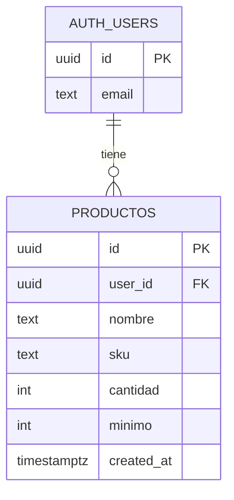
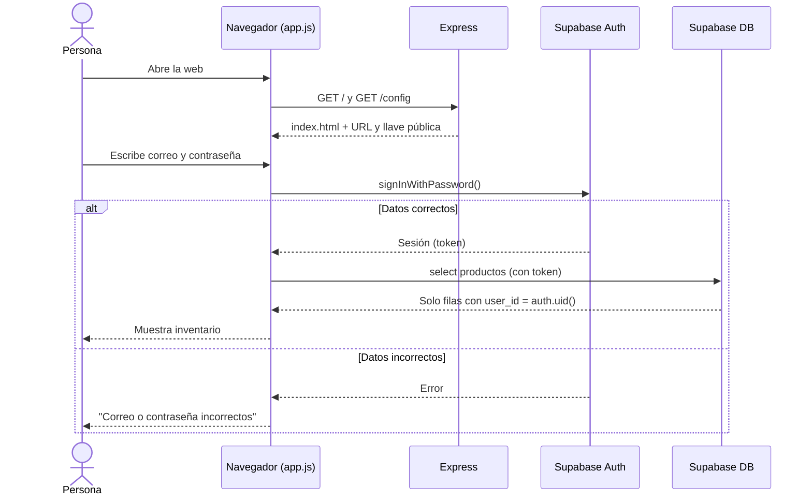

# Diseño técnico — Mini Inventario

## Tecnología

| Pieza | Tecnología | Para qué |
|---|---|---|
| Servidor | **Node.js 22 + Express** | Servir la página (HTML, CSS y JS) y la configuración pública de Supabase |
| Interfaz | **HTML + JavaScript sin framework** | Formularios de sesión y de productos, lista y filtro |
| Base de datos | **Supabase (PostgreSQL)** | Guardar la tabla `productos` |
| Inicio de sesión | **Supabase Auth** (correo y contraseña) | Crear cuentas, iniciar y cerrar sesión |

El navegador usa la librería `@supabase/supabase-js` con la **llave pública (anon)**. La **llave de servicio (service_role)** nunca se usa en el navegador ni se sube al repositorio. Las llaves van en `.env`, que está en `.gitignore`.

**Se deja fuera a propósito:** frameworks de interfaz (React, Vue), ORM, una API propia para productos, Docker y pruebas automáticas de extremo a extremo. Las 5 historias no los necesitan.

## Estructura de archivos

```
mini-inventario/
├── server.js          # Express: sirve /public y GET /config
├── public/
│   ├── index.html     # Inicio de sesión y registro
│   ├── inventario.html
│   └── app.js         # Lógica del navegador con supabase-js
├── .env.example       # SUPABASE_URL, SUPABASE_ANON_KEY (sin valores reales)
└── docs/
```

## Tabla `productos`

| Columna | Tipo | Reglas |
|---|---|---|
| `id` | `uuid` | Llave primaria, `default gen_random_uuid()` |
| `user_id` | `uuid` | `not null`, referencia a `auth.users(id)`, `default auth.uid()` |
| `nombre` | `text` | `not null`, entre 1 y 100 caracteres |
| `sku` | `text` | `not null`, entre 1 y 50 caracteres |
| `cantidad` | `integer` | `not null`, `default 0`, `>= 0` |
| `minimo` | `integer` | `not null`, `default 0`, `>= 0` |
| `created_at` | `timestamptz` | `not null`, `default now()` |

Restricción adicional: `unique (user_id, sku)`, para que nadie repita un SKU en su cuenta.

```sql
create table productos (
  id          uuid primary key default gen_random_uuid(),
  user_id     uuid not null default auth.uid() references auth.users(id) on delete cascade,
  nombre      text not null check (char_length(nombre) between 1 and 100),
  sku         text not null check (char_length(sku) between 1 and 50),
  cantidad    integer not null default 0 check (cantidad >= 0),
  minimo      integer not null default 0 check (minimo >= 0),
  created_at  timestamptz not null default now(),
  unique (user_id, sku)
);

alter table productos enable row level security;

create policy "Cada quien ve sus productos"
  on productos for select using (auth.uid() = user_id);
create policy "Cada quien crea sus productos"
  on productos for insert with check (auth.uid() = user_id);
create policy "Cada quien edita sus productos"
  on productos for update using (auth.uid() = user_id) with check (auth.uid() = user_id);
```

"Bajo mínimo" **no se guarda** en la tabla. Se calcula como `cantidad < minimo`, así nunca queda desactualizado.

## Qué valida cada capa

| Capa | Qué valida | Por qué |
|---|---|---|
| **Navegador** (HTML + `app.js`) | Campos obligatorios (`required`), números enteros y no negativos (`type="number" min="0" step="1"`), quitar espacios con `trim()`, correo válido y contraseña de 8 caracteres o más | Avisar rápido y con mensajes claros. **No es seguridad**: se puede saltar. |
| **Servidor Express** | Que exista `.env` con `SUPABASE_URL` y `SUPABASE_ANON_KEY` al arrancar; solo entrega archivos estáticos y la configuración pública | No maneja datos de productos, así que no hay nada más que validar aquí. |
| **Supabase Auth** | Correo único, contraseña mínima y sesión válida (token) en cada petición | Controla quién es cada persona. **Ojo:** Supabase pide 6 caracteres por defecto; hay que cambiarlo a **8** en *Authentication → Providers → Email → Minimum password length* para que coincida con HU-1. |
| **Base de datos** (Postgres + RLS) | `not null`, `check` de longitudes y de números `>= 0`, `unique (user_id, sku)`, y políticas RLS para que cada quien solo lea y modifique sus filas | Es la **última línea de defensa**: aunque alguien salte el navegador, aquí no pasa nada inválido. |

## Relación con las historias

| Historia | Dónde se resuelve |
|---|---|
| HU-1 Cuenta y sesión | Supabase Auth + redirección en `app.js` |
| HU-2 Registrar producto | Formulario en `inventario.html` → `insert` en `productos` |
| HU-3 Ver mis productos | `select` por `nombre`; `app.js` pone primero los bajo mínimo; RLS filtra por `user_id` |
| HU-4 Bajo mínimo | Cálculo `cantidad < minimo` en `app.js` + filtro |
| HU-5 Actualizar cantidad | `update` de `cantidad`; RLS impide tocar filas ajenas |

## Diagramas

### Tabla



### Inicio de sesión


