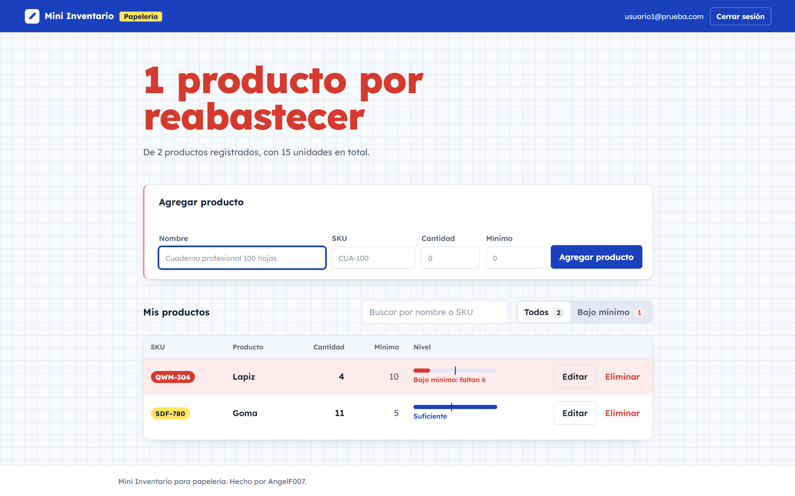
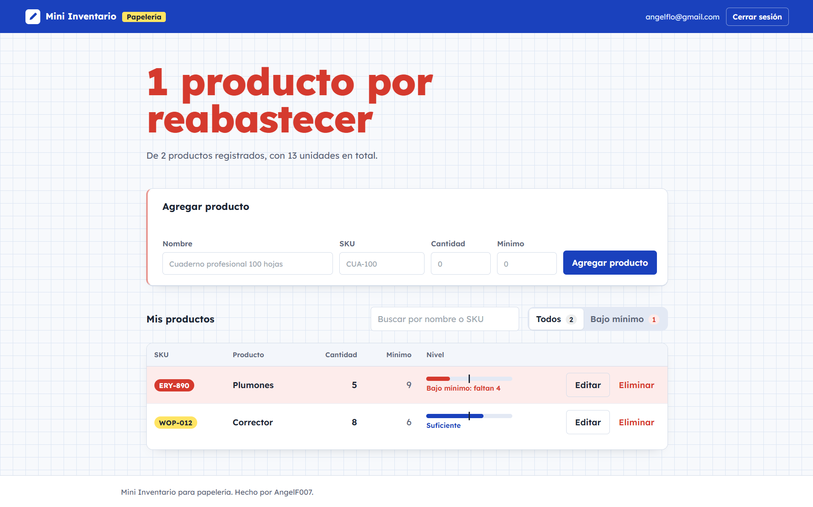

# Bitácora — Día 4: Datos reales e inicio de sesión con Supabase

**Fecha:** 2026-11-19 · **Repositorio:** https://github.com/AngelF007/mini-inventario · **Rama:** `dia-04-supabase` · **Agente:** Claude + MCP de Supabase · **Proyecto Supabase:** `mini-inventario` (ref `wbgiwuypgfamivxypcdc`)

## Capturas: cada usuario ve solo lo suyo

| Usuario 1 (`usuario1@prueba.com`) | Usuario 2 (otra cuenta) |
|---|---|
|  |  |
| Ve **Lapiz (QWM-304)** y **Goma (SDF-780)** | Ve **Plumones (ERY-890)** y **Corrector (WOP-012)** |

Ninguno ve los productos del otro.

---

## 1. Qué hice

| Paso | Resultado |
|---|---|
| Proyecto | Creé `mini-inventario` en Supabase (plan Free, us-east-1) con el MCP |
| MCP | Conecté el MCP de Supabase y lo usé **solo** con el proyecto `wbgiwuypgfamivxypcdc` |
| Tabla y reglas | Migración `crear_productos`: tabla `productos`, RLS activo y 4 políticas. También está en `supabase/migrations/` |
| Web | `public/productos.js` usa Supabase en lugar de localStorage, con registro, inicio y cierre de sesión |
| Configuración | `server.js` lee `.env` y entrega `SUPABASE_URL` y `SUPABASE_KEY` en `/config.js`. Agregué `.env.example` sin valores |
| Usuarios | Creé 2 usuarios confirmados en *Authentication → Users* |
| Extra | El buscador por nombre o SKU respeta las mismas políticas, porque busca solo dentro de lo que RLS deja ver |

---

## 2. Prompts clave

1. **Tabla:** *"Usa el MCP de Supabase solo en este proyecto y sigue las skills supabase y supabase-postgres-best-practices. Crea una migración con la tabla productos según docs/diseno.md. Activa Row Level Security y crea políticas para que cada usuario solo pueda leer, crear, editar y borrar sus propios productos. Muéstrame el SQL antes de aplicarlo."*
2. **Web:** *"Cambia public/productos.js para usar Supabase en lugar de localStorage. Agrega registro e inicio de sesión con correo y contraseña. Lee SUPABASE_URL y SUPABASE_KEY del archivo .env y entrégalas al navegador desde la ruta /config.js. Usa solo la llave publishable o anon, nunca la service_role. Crea un .env.example sin valores."*

---

## 3. SQL que aprobé (y qué hace)

Antes de aplicarlo, el agente me mostró el SQL completo y lo aprobé. Esta es la política de edición:

```sql
create policy "productos_update_propios"
  on public.productos for update
  to authenticated
  using ((select auth.uid()) = user_id)
  with check ((select auth.uid()) = user_id);
```

**Con mis palabras:**
- `for update to authenticated`: aplica cuando alguien **con sesión iniciada** intenta editar un producto.
- `using (...)`: solo puede **encontrar** para editar las filas donde `user_id` es su propio id (`auth.uid()`). Las filas de otros usuarios son invisibles para él.
- `with check (...)`: después de editar, la fila **tiene que seguir siendo suya**, así que nadie puede "regalarle" un producto a otra cuenta cambiando el `user_id`.
- `(select auth.uid())` va entre paréntesis para que Postgres lo calcule una sola vez por consulta y no en cada fila. Es una buena práctica de rendimiento.

Las otras 3 políticas (`select`, `insert` y `delete`) siguen la misma regla. Además, `user_id` tiene `default auth.uid()`, así que se llena solo con el usuario que tiene la sesión.

**Comprobación en Supabase después de aplicarlo:**
- RLS activo en `productos`: ✅
- Políticas: `SELECT`, `INSERT`, `UPDATE` y `DELETE`, todas para el rol `authenticated`: ✅
- Asesor de seguridad de Supabase: **0 avisos** ✅

---

## 4. Errores o malas decisiones de la IA

### 4.1 Las dos pantallas salían al mismo tiempo
En la primera versión, la pantalla de inicio de sesión y la del inventario se veían juntas. Usaba el atributo `hidden`, pero el CSS `main { display: grid }` le ganaba. Lo detecté porque la prueba automática reportó que las dos pantallas estaban visibles. Se corrigió con `[hidden] { display: none !important; }` antes de subirlo.

### 4.2 Un comando demasiado largo que no funcionó
Para crear el `.env` y cambiar de rama, el agente me dio un bloque grande dentro de `pwsh -Command { ... }`. No se ejecutó completo y mi servidor siguió mostrando la versión del Día 3, sin pantalla de inicio de sesión. Lo detectamos porque `/config.js` respondía 404. La solución fue darme los comandos **uno por uno**, y así funcionó.

---

## 5. Comandos aprobados y rechazados

- ✅ **Aprobado:** `apply_migration crear_productos` con el MCP. Lo aprobé después de leer el SQL, porque solo crea cosas (tabla, índice, RLS y políticas), no borra nada y el proyecto estaba vacío.
- ✅ **Aprobado:** crear el proyecto `mini-inventario` con el MCP (plan Free, $0).
- ❌ **Rechazado:** usar la llave `service_role` o secreta. Esa llave se salta RLS, y si llega al navegador cualquiera podría leer todos los productos. Uso la llave **publishable** (`sb_publishable_...`), y además `server.js` **se niega a arrancar** si `SUPABASE_KEY` es una llave secreta.

---

## 6. Secretos

```powershell
git status
git check-ignore .env
```

- `git check-ignore .env` imprime `.env`, o sea que Git lo ignora ✅
- `.env` **no** aparece en el repositorio. Solo está `.env.example`, sin valores ✅
- La llave que llega al navegador por `/config.js` es la publishable, que está diseñada para ser pública. La seguridad la da RLS ✅

---

## 7. Cómo comprobé que funciona

| Prueba | Resultado |
|---|---|
| Iniciar sesión con usuario 1 y agregar 2 productos | Se guardan en Supabase ✅ |
| Cerrar sesión y entrar con usuario 2 | Su inventario empieza vacío y **no** ve los del usuario 1 ✅ |
| Consulta en la base: productos por usuario | `usuario1@prueba.com`: Goma y Lapiz. Usuario 2: Corrector y Plumones ✅ |
| **Prueba de RLS en la base**, haciéndome pasar por el usuario 1 | Ve 2 filas (solo las suyas). Intentar **editar** los del otro: **0 filas**. Intentar **borrar** los del otro: **0 filas**. Todo se deshizo con `rollback` ✅ |
| SKU repetido, clave incorrecta, registro duplicado y eliminar con confirmación | Probados antes de conectar, con una Supabase simulada que imita RLS ✅ |

---

## 8. Nota sobre el MCP y las skills

- **MCP limitado al proyecto:** usé el conector de Supabase de Claude, que se autoriza por cuenta y no por URL con `project_ref`. Mi cuenta solo tiene **un proyecto**, y todas las llamadas usaron `project_id = wbgiwuypgfamivxypcdc`. La aprobación fue manual: el agente me pidió permiso antes de crear el proyecto y antes de aplicar el SQL.
- **Skills:** `npx skills add ...` es para Claude Code o Codex. Mi agente no las usa, así que seguí sus buenas prácticas a mano: `(select auth.uid())` en las políticas, `to authenticated`, índice en `user_id` y `on delete cascade`. Lo verifiqué con el asesor de seguridad de Supabase, que dio 0 avisos.
