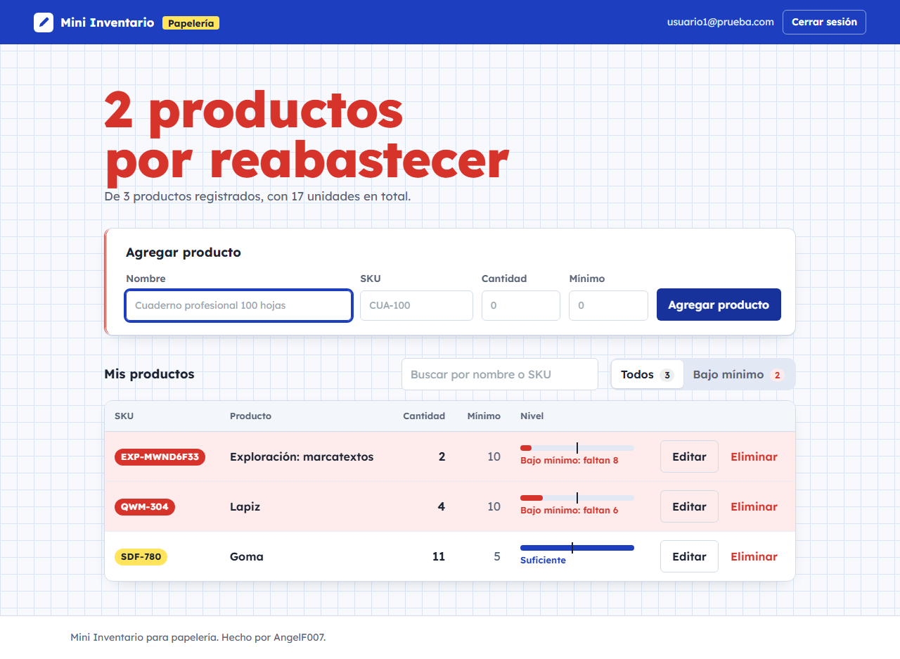
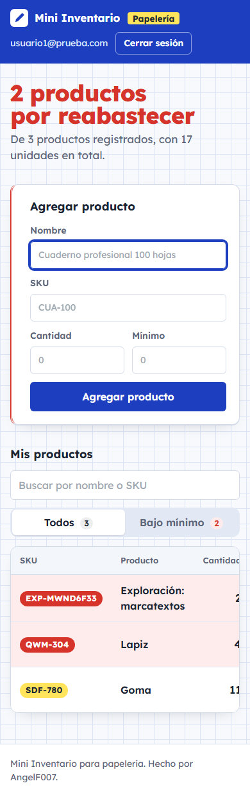

# Bitácora — Día 5: Pruebas con los ojos del agente

**Fecha:** 2026-11-19 · **Repositorio:** https://github.com/AngelF007/mini-inventario · **Rama:** `dia-05-pruebas` · **Agente:** Claude · **Herramienta:** Playwright

## Evidencias en esta carpeta

| Archivo | Qué muestra |
|---|---|
| `01-acceso-1280.png` | Pantalla de acceso en escritorio |
| `02-inventario-1280x800.png` | Inventario con el producto de exploración bajo el mínimo (escritorio) |
| `03-inventario-390x844.png` | La misma pantalla en celular: **aquí está el problema** |
| `consola.md` | Reporte de la exploración y de la consola |
| `pruebas-1-pasan.txt` | Primera corrida: 6 de 6 pasan |
| `pruebas-2-falla.txt` | Con el error provocado: falla la prueba de bajo mínimo |
| `pruebas-3-revertido.txt` | Después de revertir: 6 de 6 pasan otra vez |

---

## 1. Exploración

`npm run explorar` (`scripts/explorar.mjs`) usa Playwright para abrir http://localhost:3000. Inicia sesión con `TEST_EMAIL` y `TEST_PASSWORD` de `.env` **sin mostrarlos**, agrega un producto con cantidad 2 y mínimo 10, toma capturas en **1280x800** y **390x844**, revisa la consola y **borra el producto al terminar**.

| | Escritorio 1280x800 | Celular 390x844 |
|---|---|---|
| Captura |  |  |

**Consola:** sin errores ni avisos (ver `consola.md`).

---

## 2. Problema real encontrado y corregido

**Problema:** en celular, la tabla de productos mide **833px** dentro de una caja de **356px**. Solo se ven el SKU, el nombre y la mitad de la cantidad. El **mínimo**, la **barra de nivel** y los botones **Editar** y **Eliminar** quedan fuera de la pantalla (Editar en x=658, cuando la pantalla mide 390). No hay ninguna señal de que se pueda deslizar, así que en celular **no se puede editar ni borrar** un producto. Se ve en la captura `03-inventario-390x844.png`, y el reporte de la exploración lo confirma con números.

**Corrección** (`public/styles.css` + `public/app.js`):
- En pantallas de 640px o menos, **cada producto se muestra como tarjeta**: SKU y nombre arriba, cantidad y mínimo con su etiqueta, la barra de nivel y los botones abajo.
- Los productos bajo el mínimo conservan el fondo rojo.
- En escritorio no cambia nada.

**Comprobación:** con el mismo script contra la versión corregida (corrida con datos simulados), la tabla mide 358px en una caja de 358px y el botón Editar queda en x=31, visible. Además, las 6 pruebas siguen pasando con la corrección.

**De paso:** el texto decía "De 1 producto **registrados**". Ahora concuerda: "1 producto registrado" y "3 productos registrados".

---

## 3. Pruebas permanentes (`tests/`)

`playwright.config.js` arranca la app con `webServer` (`npm start`, espera a `/health`) y lee `.env`.

| # | Prueba | Qué comprueba |
|---|---|---|
| 1 | inicia sesión con el usuario de prueba | Entra y muestra su correo arriba |
| 2 | rechaza una contraseña incorrecta | Muestra "Correo o contraseña incorrectos." y sigue en la pantalla de acceso |
| 3 | agrega un producto | La fila aparece con su nombre y "Suficiente" |
| 4 | marca un producto bajo el mínimo | `2 < 5` se marca **y** `5 = 5` **no** se marca (HU-4) |
| 5 | edita la cantidad y cambia el estado | *(extra)* Al bajar de 10 a 1, pasa a "Bajo mínimo: faltan 4" |
| 6 | no guarda con campos vacíos | *(extra)* "Faltan: nombre, SKU, cantidad y mínimo." y no cambia la lista |

**Sin datos de prueba:** cada prueba usa un **SKU único** (por ejemplo `AGR-…`, `BAJ-…`) y los borra en `afterEach`, que corre **aunque la prueba falle**. Lo comprobé en Supabase después de las 3 corridas, incluida la que falló: **0 productos de prueba** en la base, y los 2 productos de mi usuario de prueba siguen intactos.

**Resultado** (`pruebas-1-pasan.txt`): **6 passed**.

---

## 4. Las pruebas detectan errores

1. **Provoqué el error:** en `public/app.js` cambié `producto.cantidad < producto.minimo` por `producto.cantidad <= producto.minimo`.
2. **Corrí las pruebas** (`pruebas-2-falla.txt`): **1 failed, 5 passed**. Falló justo "marca un producto bajo el mínimo":
   ```
   Error: expect(locator).not.toHaveClass(expected) failed
   Expected pattern: not /\bbajo\b/
   Received string: "bajo"
   ```
   Es decir, un producto con cantidad **igual** al mínimo apareció marcado, cuando no debe.
3. **Revertí** con `git checkout -- public/app.js` y corrí otra vez (`pruebas-3-revertido.txt`): **6 passed**.

---

## 5. Prompts clave

1. **Exploración:** *"Arranca la app. Usa playwright-cli para abrir http://localhost:3000, iniciar sesión con TEST_EMAIL y TEST_PASSWORD de .env sin mostrarlos, y agregar un producto con cantidad menor al mínimo. Toma capturas en 1280x800 y en 390x844, y revisa los errores de consola. Guarda las capturas en entregas/dia-05/ y reporta lo que encontraste. No corrijas nada todavía."*
2. **Pruebas:** *"Escribe pruebas de Playwright en tests/ para: iniciar sesión, rechazar una contraseña incorrecta, agregar un producto y marcar un producto bajo el mínimo. Lee TEST_EMAIL y TEST_PASSWORD del entorno. Cada prueba usa un SKU único y borra lo que creó. Configura webServer para arrancar la app. Corre las pruebas y muéstrame el resultado."*
3. **Corrección:** a partir de la captura de celular, el problema elegido fue que en pantallas chicas no se ven el mínimo ni los botones Editar y Eliminar.

---

## 6. Errores o malas decisiones de la IA

### 6.1 La exploración dependía de tener el servidor prendido en otra ventana
La primera versión de `explorar.mjs` suponía que yo tenía `npm start` corriendo en otra ventana. No lo tenía, y falló con `page.goto: net::ERR_CONNECTION_REFUSED at http://localhost:3000/`. Lo detecté por ese error en la terminal. Se corrigió para que el script **revise `/health` y, si la app no responde, la prenda él mismo** y la apague al final.

### 6.2 Una prueba podía mezclar dos productos
En la primera versión, `agregarProducto` daba clic en "Agregar" y seguía sin esperar. Con la latencia real de Supabase, el formulario se limpia cuando termina el primer guardado, y eso puede borrar a la mitad lo que ya se estaba escribiendo del segundo producto (en la prueba de bajo mínimo se agregan dos seguidos). El agente lo detectó al revisar el código antes de subirlo. Ahora la función **espera a que aparezca la fila** antes de continuar.

---

## 7. Herramientas y comandos aprobados o rechazados

- ❌ **No instalé `playwright-cli` global** (`npm install -g @playwright/cli@latest`). Usé `@playwright/test` como dependencia **del proyecto**, porque así cualquiera que clone el repo tiene la misma versión con `npm install`, no hay que instalar nada global en la máquina y el mismo paquete sirve para la exploración y para las pruebas.
- ✅ **Aprobé `gh auth setup-git`**, que conecta Git con mi sesión de GitHub CLI para que `git push` no pida usuario y contraseña.
- 🔒 **Mi contraseña nunca pasó por el agente:** la escribí yo con `Read-Host -MaskInput` directo en `.env`, que está en `.gitignore`. Los scripts la leen de ahí.

---

## 8. Cómo comprobé que funciona

| Qué | Resultado |
|---|---|
| `npm run explorar` | Capturas en 1280x800 y 390x844; consola sin errores; producto de exploración borrado |
| `npx playwright test` | 6 passed |
| Error provocado (`<=`) | 1 failed: justo la prueba de bajo mínimo |
| Revertido | 6 passed |
| Supabase después de las pruebas | 0 productos de prueba; datos del usuario intactos |
| `.env` en el repositorio | No está; solo `.env.example` con `TEST_EMAIL=` y `TEST_PASSWORD=` vacíos |
