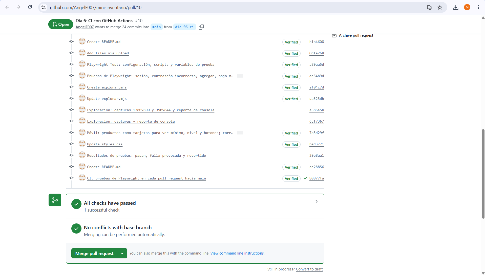
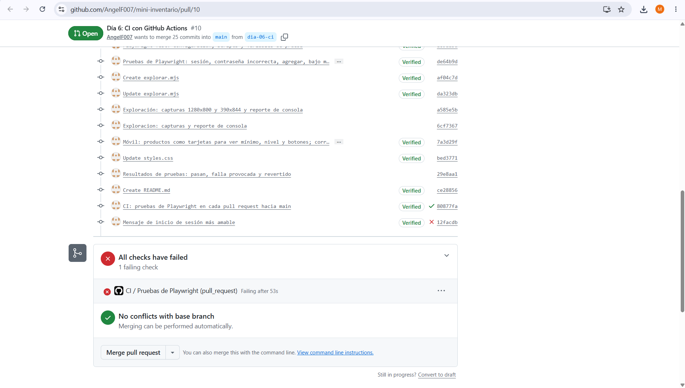

# Bitácora — Día 6: CI con GitHub Actions

**Fecha:** 2026-11-19 · **Repositorio:** https://github.com/AngelF007/mini-inventario · **Rama:** `dia-06-ci` · **PR:** [#10](https://github.com/AngelF007/mini-inventario/pull/10) · **Agente:** Claude

## Evidencias en esta carpeta

| Archivo | Qué muestra |
|---|---|
| `ci-verde.png` | Primera corrida del PR #10 en verde |
| `ci-rojo.png` | El mismo PR en rojo después del cambio que rompió la prueba |
| `gh-pr-checks.txt` | Salida de `gh pr checks 10` con la falla |
| `gh-run-list.txt` | Salida de `gh run list` con las corridas |
| `gh-log-failed.txt` | Salida de `gh run view --log-failed`: el log de la prueba que falló |

---

## 1. Prompts que usé

1. "Haz la actividad del día 6": crear el flujo de CI que corra las pruebas de Playwright en cada pull request hacia `main`, con las llaves guardadas como secretos.
2. Cuando la CI quedó en verde, le pedí al agente un cambio pequeño en la app. Ese cambio rompió una prueba y la CI se puso en rojo.
3. "Diagnostica la falla con `gh`, sin abrir la página de Actions." Yo corrí los comandos y le pasé las salidas.
4. Revisé su propuesta y aprobé la opción **"Regresar el mensaje"**.

---

## 2. Cómo funciona la CI (`.github/workflows/ci.yml`)

Corre en cada **pull request hacia `main`**. También se puede lanzar a mano con `workflow_dispatch`.

| Paso | Qué hace |
|---|---|
| Descargar el código | `actions/checkout@v4` |
| Revisar que existan los secretos | Si falta alguno, falla con un mensaje claro y no deja seguir |
| Instalar Node 22 | `actions/setup-node@v4` con caché de npm |
| Instalar dependencias | `npm ci` (usa el `package-lock.json`) |
| Instalar Chromium | `npx playwright install --with-deps chromium` |
| Correr las pruebas | `npx playwright test`: las 6 pruebas del día 5 |
| Subir el reporte | Artefacto `reporte-playwright` (se guarda 14 días), **aunque las pruebas fallen** |

El flujo además tiene:
- `permissions: contents: read`: el flujo solo puede leer el repositorio.
- `concurrency`: si subo otro commit, cancela la corrida anterior del mismo PR.
- `timeout-minutes: 15`, para que una corrida atorada no se quede corriendo.

## 3. Secretos

Los 4 valores están en **Settings → Secrets and variables → Actions**: `SUPABASE_URL`, `SUPABASE_KEY`, `TEST_EMAIL` y `TEST_PASSWORD`.

- Los cargué con `gh secret set -f .env`, que lee mi `.env` local. **No escribí ni pegué ninguna llave o contraseña en la conversación con el agente.**
- `gh secret list` muestra solo los nombres y la fecha, nunca los valores.
- El código no tiene llaves. `.env` está en `.gitignore`, y GitHub oculta los secretos en los logs (`***`).
- `SUPABASE_KEY` es la llave **publicable**. El servidor rechaza una llave `service_role` o `sb_secret_`.

---

## 4. Verde → rojo → verde (el mismo PR #10)

| Commit | Qué cambió | Corrida | Resultado |
|---|---|---|---|
| `80877fa` | Agrega el flujo de CI | 44584492123 | ✅ verde |
| `12facdb` | El mensaje de error de inicio de sesión cambia a "El correo o la contraseña no coinciden." | 44585253168 | ❌ rojo |
| `3962de9` | Subo las salidas de `gh` (el mensaje seguía cambiado) | 44586337327 | ❌ rojo |
| `00ed2f4` | Regresa el mensaje a "Correo o contraseña incorrectos." | 44586579194 | ✅ verde (6 de 6, 45 s) |

| Verde | Rojo |
|---|---|
|  |  |

## 5. Diagnóstico con `gh` (con mis palabras)

Corrí `gh pr checks 10`, `gh run list` y `gh run view --log-failed`. El log dice que falló **la prueba 2, "rechaza una contraseña incorrecta"**:

```
Expected: "Correo o contraseña incorrectos."
Received: "El correo o la contraseña no coinciden."
```

**Causa:** el cambio "más amable" reescribió el mensaje que la app muestra cuando la contraseña está mal. La prueba busca el texto exacto que pide la historia **HU-1**, y como ya no lo encontró, falló. La falla no tiene que ver con los secretos ni con Supabase: el inicio de sesión sí respondió, y el paso que revisa los secretos pasó. La app funcionaba, pero dejó de cumplir lo que acordamos en HU-1, y la CI lo detectó antes de llegar a `main`.

**Corrección:** había dos opciones: cambiar la prueba y HU-1, o regresar el mensaje. Elegí regresar el mensaje en `public/productos.js`, porque HU-1 es el acuerdo y la prueba lo estaba cuidando bien. Con eso la CI volvió a verde.

---

## 6. Un error del agente

Cuando le pasé las primeras salidas de `gh`, salieron mal porque mi copia local seguía en la rama `dia-05-pruebas`, y el agente no me había dicho que cambiara de rama. Lo corrigió con `git fetch`, `git switch dia-06-ci` y `mkdir entregas\dia-06`, y después de eso los comandos funcionaron.

## 7. Comandos aprobados y rechazados

- **Aprobado:** `gh secret set -f .env`. Lo preferí a escribir cada valor a mano, porque así ninguna llave pasa por la pantalla ni por la conversación.
- **No aprobado:** que el agente hiciera merge por su cuenta. Un intento de merge de un PR anterior quedó bloqueado y no se hizo. Por eso armé `dia-06-ci` desde `dia-05-pruebas`, para que el PR #10 apunte a `main` sin mezclar nada antes. El merge lo hago yo, después de revisar el PR.

## 8. Verificación

- Corrida final 44586579194: todos los pasos en verde, incluidas "Revisar que existan los secretos" y "Correr las pruebas de Playwright".
- El PR #10 muestra el check **CI / Pruebas de Playwright** en verde, en el mismo PR que antes estaba en rojo.
- `public/productos.js` en la rama `dia-06-ci` tiene otra vez "Correo o contraseña incorrectos.", igual que HU-1 y la prueba 2.
