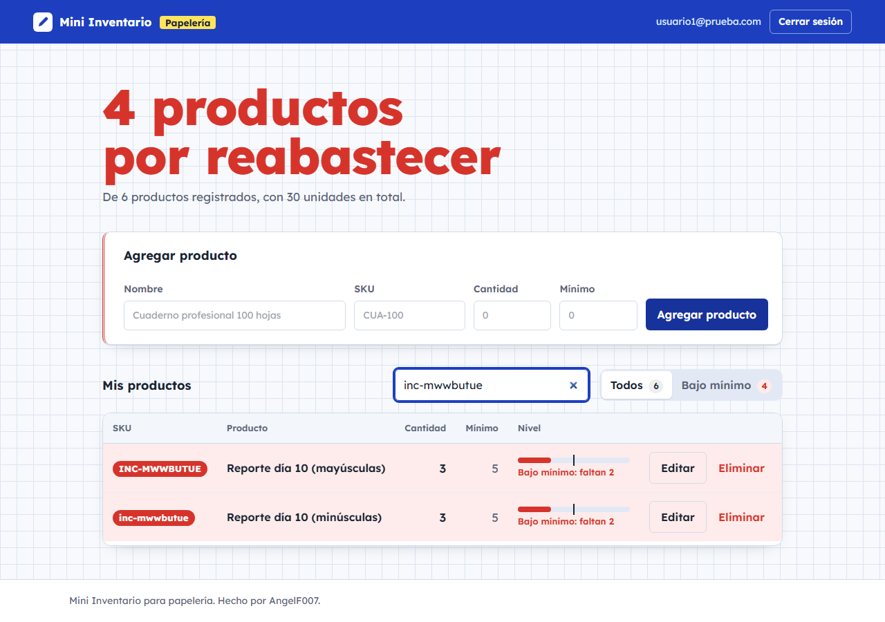
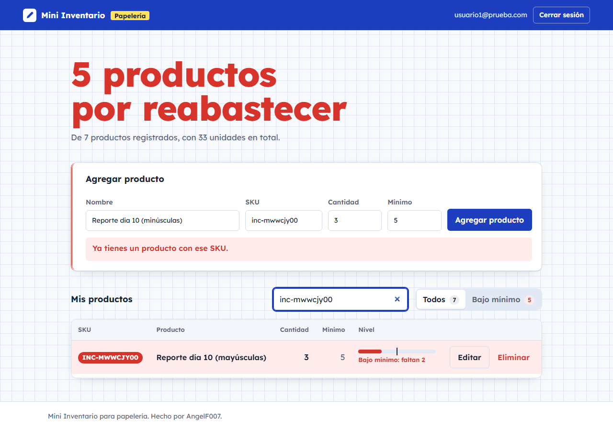

# Bitácora — Día 10: Resuelve un incidente de principio a fin

**Fecha:** 2026-11-25 · **Repositorio:** https://github.com/AngelF007/mini-inventario · **Agente:** Claude (y Claude Code en mi compu con el MCP de Render y el MCP `inventario`)

## Enlaces de la entrega

| | |
|---|---|
| **URL pública** | https://mini-inventario-m9u5.onrender.com |
| **Issue** | [#15 — Incidente: se puede registrar el mismo SKU con otras mayúsculas](https://github.com/AngelF007/mini-inventario/issues/15) (cerrado por el PR) |
| **Pull request** | [#16 — El SKU no se puede repetir con otras mayúsculas (cierra #15)](https://github.com/AngelF007/mini-inventario/pull/16) |

---

## 1. El reporte y mi hipótesis

El primer reporte (*"Pude guardar un producto con cantidad -5"*) **mi app ya lo bloquea**: la web solo acepta dígitos (`/^\d+$/`) y la tabla tiene `check (cantidad >= 0)`. Por eso usé el segundo, como indica la guía:

> **"Pude registrar dos productos con el mismo SKU."**

**Lo que creí que pasaba, antes de pedir ayuda:** la tabla tiene `unique (user_id, sku)`, así que un SKU idéntico se rechaza. Pero un `unique` sobre texto distingue mayúsculas, y la web solo hace `trim()`. Entonces `CUA-100` y `cua-100` deberían entrar como si fueran dos SKUs distintos.

Antes de probar desperté el servicio de Render: el script espera a que `/health` responda.

## 2. Reproducción e investigación

**Reproducción en producción** con `scripts/reproducir-incidente.mjs`. Usa Playwright: inicia sesión en la URL pública con el usuario de prueba de `.env`, agrega el mismo SKU en mayúsculas y en minúsculas, cuenta cuántos quedaron y toma la captura ([`reproduccion-antes.txt`](reproduccion-antes.txt)):

```
Sesión iniciada como usuario1@prueba.com
1) Agregar SKU "INC-MWWBUTUE": GUARDADO
2) Agregar SKU "inc-mwwbutue": GUARDADO
Filas con el SKU INC-MWWBUTUE (sin importar mayúsculas): 2 -> ["INC-MWWBUTUE","inc-mwwbutue"]
RESULTADO: el reporte SE REPRODUCE (SKU duplicado guardado).
```



**Investigación con el agente** ([`1-investigacion.md`](1-investigacion.md)). Prompt (el de la guía, adaptado; con permiso solo de lectura):

> Tenemos este reporte de producción: 'Pude registrar dos productos con el mismo SKU'. Ya lo reproduje en la URL pública con Playwright; este fue el resultado: […]. Revisa los logs recientes del servicio mini-inventario con el MCP de Render y consulta los datos con el MCP inventario, que es de solo lectura. Lee también public/productos.js y supabase/migrations/ para ver cómo se valida el SKU. Explica la causa exacta. No cambies nada todavía.

Lo que encontró el agente:
- **Migración:** `constraint productos_user_sku_unico unique (user_id, sku)` compara el texto tal cual.
- **Web:** `validar()` solo hace `trim()`, así que el SKU llega a Supabase como se escribió, al agregar y al editar.
- **Datos (MCP `inventario`, solo lectura):** las dos filas, `INC-MWWBUTUE` e `inc-mwwbutue`, existen en la base. No es solo algo que se vea en pantalla.
- **Logs de Render:** solo `Mini Inventario escuchando en 0.0.0.0:10000`, sin errores. Tiene sentido: el guardado va del navegador directo a Supabase y no pasa por Express, y Supabase aceptó los dos.
- **Conclusión:** la causa es la regla de unicidad que distingue mayúsculas. No es RLS, Render ni el servidor.

Para la consulta de datos usé el MCP `inventario` del día 8, en lugar de `supabase-lectura`, porque ese necesitaba volver a autenticarse. Los dos son de solo lectura.

## 3. Issue

Lo creé con `gh issue create --body-file entregas/dia-10/issue.md` desde `prueba.ps1`: **[#15](https://github.com/AngelF007/mini-inventario/issues/15)**. Incluye:
- los **pasos para reproducir** con los SKUs reales;
- la **causa** en la base y en la web;
- lo que **no** es la causa;
- 5 **criterios de aceptación**: prueba que falla antes y pasa después, web, base, filas incorrectas, y CI y producción.

## 4. Primero la prueba

En la rama `dia-10-incidente` agregué la prueba **"no deja registrar el mismo SKU con otras mayúsculas"** en `tests/inventario.spec.js`. Sigue la skill `pruebas-inventario` del día 7:
- SKU único;
- selectores por etiqueta y rol;
- el mensaje exacto de la app;
- borrado en `afterEach`.

También cambié `borrarPorSku`, porque antes fallaba si había dos filas con el mismo SKU. Ahora borra todas las que coincidan.

**Antes de corregir: FALLA** ([`prueba-antes.txt`](prueba-antes.txt)):

```
x  1 [chromium] › tests\inventario.spec.js:123:3 › Productos › no deja registrar el mismo SKU con otras mayúsculas (18.0s)
   Error: expect(locator).toHaveText(expected) failed
   Locator: getByRole('alert')
   Expected: "Ya tienes un producto con ese SKU."
   Error: element(s) not found
1 failed
```

## 5. Corrección en la web y en la base

Prompt (el de la guía):

> Corrige el issue validando el dato en la web y agregando una restricción en la base con una migración mediante el MCP de Supabase. Primero muéstrame cuántas filas incumplen la regla y propón qué hacer con ellas. Espera mi aprobación antes de modificar datos o aplicar el SQL. Después corre las pruebas.

**Filas que incumplían la regla:** el agente consultó la base, solo con lectura, y encontró **1 grupo con 2 filas**, ambas de `usuario1@prueba.com` y creadas por la reproducción:

| SKU | Nombre | Creado |
|---|---|---|
| `INC-MWWBUTUE` | Reporte día 10 (mayúsculas) | 16:17:41 |
| `inc-mwwbutue` | Reporte día 10 (minúsculas) | 16:17:42 (la copia) |

Me propuso 4 opciones: borrar solo la copia, borrar las dos, renombrar la copia o no tocar nada. **Aprobé borrar solo la copia** (`inc-mwwbutue`). Era la fila que causaba el conflicto y la otra era el dato original. Después de eso el agente aplicó la migración.

**Web** (`public/productos.js`): el SKU se guarda en mayúsculas.
```js
sku: String(sku ?? '').trim().toUpperCase(),
```

**Base** (`supabase/migrations/20261125000000_sku_unico_sin_mayusculas.sql`, aplicada con el MCP de Supabase):
```sql
create unique index if not exists productos_user_sku_normalizado_unico
  on public.productos (user_id, upper(btrim(sku)));
```

**Comprobación directa en la base**, sin pasar por la web: insertar `' inc-mwwbutue '` (con espacios y en minúsculas) dio:
```
duplicate key value violates unique constraint "productos_user_sku_normalizado_unico"
```

**Después de corregir: PASA** ([`prueba-despues.txt`](prueba-despues.txt)):
```
ok 1 [chromium] › tests\inventario.spec.js:123:3 › Productos › no deja registrar el mismo SKU con otras mayúsculas (8.6s)
1 passed (11.5s)
```

## 6. Publicación y verificación

- Abrí el PR [#16](https://github.com/AngelF007/mini-inventario/pull/16) con `Closes #15`. **La CI quedó en verde** con todas las pruebas, incluida la nueva. Hice merge, el issue #15 se cerró solo y Render desplegó.
- Comprobé que la URL pública ya sirve el código nuevo: `productos.js` en producción tiene `sku: String(sku ?? '').trim().toUpperCase()`.
- **Repetí el caso en la URL pública** ([`reproduccion-desplegado.txt`](reproduccion-desplegado.txt)):
  ```
  1) Agregar SKU "INC-MWWCJY00": GUARDADO
  2) Agregar SKU "inc-mwwcjy00": RECHAZADO — Ya tienes un producto con ese SKU.
  RESULTADO: el reporte YA NO ocurre (solo un producto con ese SKU).
  ```



**Algo que salió de más:** por error corrí la verificación **antes** de hacer merge ([`reproduccion-despues.txt`](reproduccion-despues.txt)), y aun así salió **RECHAZADO**. La web publicada todavía era la vieja, pero **la base ya tenía el índice**. Eso demuestra que la protección en la base funciona sola, aunque la web falle o alguien use la API directo. Por eso la guía pide protegerlo en los dos lugares.

---

## 7. Errores y malas decisiones de la IA

1. **Texto con acentos roto.** El script `investigar.ps1` leía el resultado de la reproducción con `Get-Content -Raw`. En PowerShell 5.1 eso lee el UTF-8 como si fuera Latin-1, así que el agente recibió `Reproducción` en lugar de `Reproducción`. Lo notó el propio agente al final de su respuesta. No cambió el diagnóstico, pero el script debió leer con `-Encoding UTF8`.
2. **`git push` sin rama remota.** El mismo script hacía `git push` en una rama nueva que todavía no existía en GitHub y falló con *"has no upstream branch"*. Lo vi en la terminal y lo arreglé con `git push -u origin dia-10-incidente`. El script debió usar `-u` desde el principio.
3. **Subidas que "parecían" funcionar.** Durante la falla de GitHub de esa mañana (Issues y Pull Requests con *Major Outage* en githubstatus.com), algunas subidas de archivos dijeron que sí, pero el commit no llegó. El agente lo detectó comparando el hash de cada archivo en la rama contra el local y repitió las que faltaban, en vez de asumir que estaban arriba.

## 8. Comandos aprobados y rechazados

- ✅ **Borrar solo la copia** `inc-mwwbutue` antes de aplicar la migración. No aprobé borrar las dos, porque la original no estorbaba.
- ✅ **Aplicar la migración** con el MCP de Supabase, después de ver las filas afectadas.
- ✅ Investigar solo con herramientas de lectura: MCP de Render con llave Read only, MCP `inventario` con el usuario `inventario_lector`, y `Read`/`Grep` para el código.
- ❌ Que el agente cambiara algo durante la investigación: el prompt dice "No cambies nada todavía" y no tenía herramientas de escritura.
- ❌ Hacer merge sin la CI en verde: esperé "All checks have passed".

## 9. Cómo comprobé que funciona

- La prueba nueva **falla antes** y **pasa después** (`prueba-antes.txt` / `prueba-despues.txt`), y la CI del PR #16 quedó en verde con todo el conjunto de pruebas.
- La base rechaza el duplicado directo con `productos_user_sku_normalizado_unico`.
- La URL pública rechaza el caso y sirve el `productos.js` nuevo.
- Revisé que ya no hay grupos de SKU duplicados en la tabla.

---

## 10. Cierre del ciclo

**Qué aprendió el sistema.** "Único" no es lo mismo que "idéntico": para una persona, `CUA-100` y `cua-100` son el mismo producto. Ahora la regla está en tres lugares:
- la **web** normaliza el SKU;
- la **base** lo hace cumplir con un índice;
- una **prueba** lo vigila en cada PR.

También quedó probado que la regla en la base es la que de verdad protege, aunque la web falle.

**Siguiente requisito.** Normalizar del mismo modo otros campos que una persona considera "iguales":
- quitar espacios dobles dentro del SKU, como `CUA  100`;
- avisar en el formulario, mientras se escribe, que ese SKU ya existe, antes de dar clic en Agregar.

Y como historia nueva: **"Como encargado, quiero ver un historial de cambios de cantidad de cada producto, para saber quién y cuándo lo modificó"**, porque hoy un dato incorrecto no deja rastro.

**Qué le delegaría a un agente:**
- reproducir el reporte con Playwright;
- juntar logs y datos de solo lectura;
- escribir la prueba que falla;
- proponer la migración;
- redactar el issue y el PR.

Es trabajo repetible y verificable.

**Qué seguiría revisando yo:**
- cualquier **cambio a datos de producción**, como qué filas borrar y si respaldar antes;
- el **SQL de la migración** antes de aplicarlo;
- que la prueba **de verdad falle** antes de corregir y no pase por casualidad;
- los **permisos** que le doy a cada MCP (solo lectura siempre que se pueda);
- el **merge** final.
